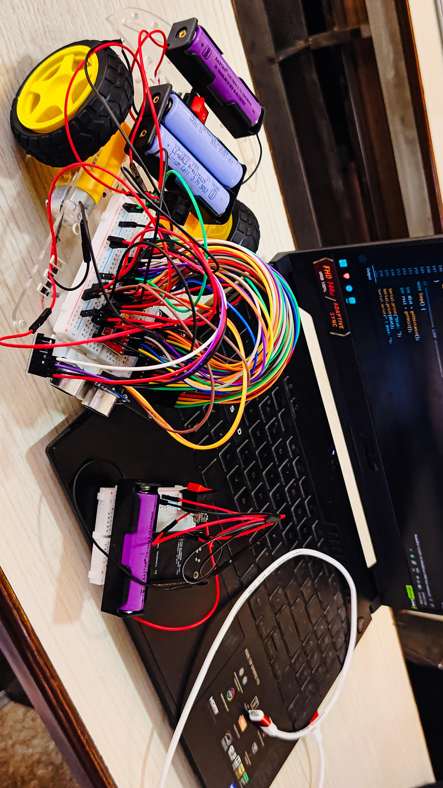
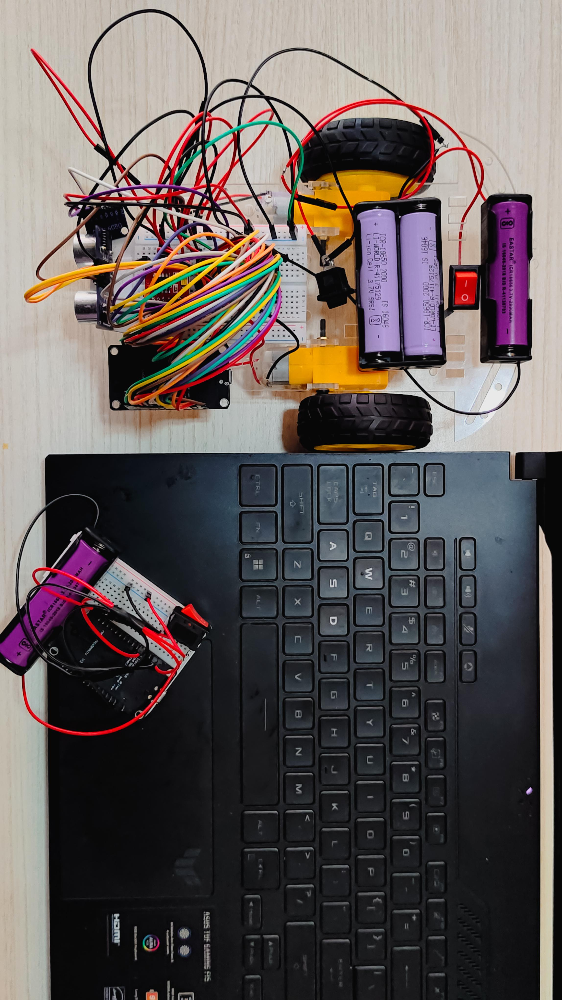
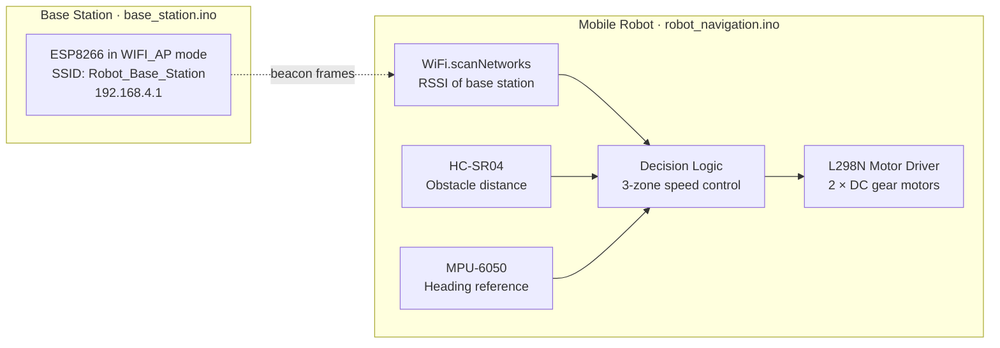
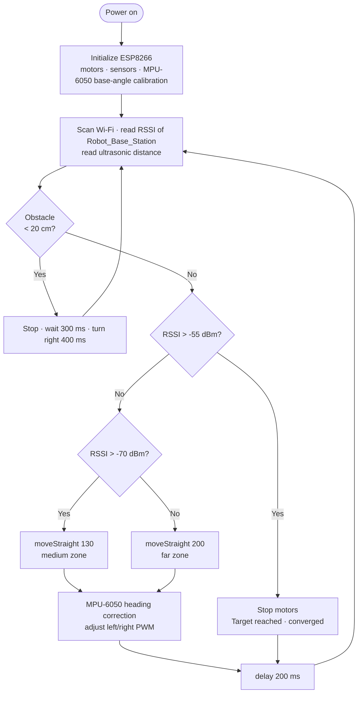

# RSSI-Based Gradient Descent for Collaborative Robot Localization and Navigation

**A GPS-free, low-cost IoT robot that navigates toward a Wi-Fi signal source using RSSI feedback, gradient-descent-style speed control, ultrasonic obstacle avoidance, and IMU heading correction — built on ESP8266 NodeMCU.**

The robot scans for a base-station access point, reads its signal strength (RSSI), and drives toward the stronger signal, slowing down as it gets closer. No GPS, no beacons, no cameras, no central controller.

> MCA (AI & ML) Semester II project · K.R. Mangalam University, Gurugram · Projexa Team ID 26E1214
> Research paper accepted at **SASIGD 2026**.

---

## Quick Links

- [Overview](#overview)
- [Hardware Prototype](#hardware-prototype)
- [System Architecture](#system-architecture)
- [How It Works](#how-it-works)
- [Hardware](#hardware)
- [Pin Mapping](#pin-mapping)
- [Getting Started](#getting-started)
- [Project Structure](#project-structure)
- [Results](#results)
- [Research Paper (Simulation)](#research-paper-simulation)
- [Limitations](#limitations)
- [Future Work](#future-work)
- [Team](#team)
- [References](#references)

---

## Overview

GPS fails indoors, underground, and in disaster zones, and the alternatives (LiDAR, vision SLAM, BLE beacon fingerprinting) are expensive, compute-heavy, or need pre-installed infrastructure. This project shows that a robot built from commodity IoT parts can navigate toward a target using only the Wi-Fi signal strength it already measures.

- **GPS-free** — RSSI from Wi-Fi is the only localization signal.
- **Infrastructure-free** — a single ESP8266 acts as the signal source; nothing else to install.
- **Low cost** — roughly **USD 12–18 per robot unit** (ESP8266 + sensors + chassis).
- **Autonomous** — real-time obstacle avoidance and heading correction with no human control.
- **Gradient-descent-inspired control** — large steps (high speed) far from the target, small steps (low speed) near it.

---

## Hardware Prototype

| View | Image |
|---|---|
| Robot and base station during live testing, serial monitor streaming distance and RSSI |  |
| Top view — chassis, motors, battery packs, wiring, and base-station node |  |

---

## System Architecture

The system runs two separate firmwares on two ESP8266 NodeMCU boards.



- **Base station** (`firmware/base_station/base_station.ino`) — stays in one place and broadcasts a Wi-Fi access point. The loop is empty; the Wi-Fi stack's beacon frames are the signal the robot measures.
- **Robot** (`firmware/robot_navigation/robot_navigation.ino`) — runs in station mode (scan only, never connects), measures the base station's RSSI each cycle, and decides how to move.

---

## How It Works



### 1. RSSI measurement
`getRSSI()` scans for networks, finds `Robot_Base_Station`, and returns its RSSI in dBm. If the base station is not found it returns `-100` dBm. A scan takes roughly 100–300 ms on the ESP8266.

### 2. Gradient-descent-inspired speed control
RSSI is mapped to speed with a three-band rule, so step size shrinks as the robot nears the optimum:

| RSSI | Zone | Action |
|---|---|---|
| > -55 dBm | Converged | Stop motors |
| -70 to -55 dBm | Medium | `moveStraight(130)` |
| < -70 dBm | Far | `moveStraight(200)` |

Thresholds (`closeRSSI`, `midRSSI`) are configurable and should be tuned for your environment.

### 3. Obstacle avoidance
Obstacle handling has priority over navigation. If the HC-SR04 reads under 20 cm, the robot stops, waits 300 ms, turns right for 400 ms, and resumes navigation.

### 4. MPU-6050 straight-line correction
Differential motor speed mismatch makes the robot drift. `moveStraight()` reads the `ay` axis, compares it with the base angle calibrated at startup, and trims left and right PWM:

```
error      = ay - baseAngle
correction = error / 500          // tune divisor for sensitivity
leftSpeed  = constrain(baseSpeed - correction, 100, 255)
rightSpeed = constrain(baseSpeed + correction, 100, 255)
```

---

## Hardware

| Component | Specification | Purpose |
|---|---|---|
| ESP8266 NodeMCU v3 × 2 | Xtensa LX106, 80/160 MHz, Wi-Fi 802.11 b/g/n, 3.3 V logic | One base station (AP), one robot controller |
| L298N motor driver | Dual H-bridge, 5–35 V, 2 A per channel | PWM speed and direction control |
| DC gear motors × 2 | 6 V, 150–200 RPM | Differential-drive locomotion |
| HC-SR04 ultrasonic sensor | 2–400 cm, 15° beam, 40 kHz | Frontal obstacle detection (< 20 cm) |
| MPU-6050 IMU | 3-axis gyro + 3-axis accelerometer, I²C | Heading stability and straight-line correction |
| LM2596 buck converter (HW-411) | In 4.5–40 V, out 1.25–37 V, 3 A | Regulated supply for ESP8266 and sensors |
| Battery packs | Separate packs for robot and base station | Power |
| Two-wheel acrylic chassis + caster | — | Structural platform |
| Half-size breadboard, Dupont jumper wires, push-button switch | — | Wiring and power control |

**Software:** Arduino IDE 2.3 with ESP8266 Arduino Core 3.x, Embedded C/C++, `ESP8266WiFi.h`, `Wire.h`, `MPU6050.h` (i2cdevlib), and Python 3 (pySerial, NumPy, Matplotlib) for serial logging and plotting.

---

## Pin Mapping

ESP8266 NodeMCU (robot node):

| NodeMCU Pin | GPIO | Connected to | Function |
|---|---|---|---|
| D0 | GPIO16 | TRIG (HC-SR04) | Ultrasonic trigger pulse |
| D1 | GPIO5 | SCL (MPU-6050) | I²C clock |
| D2 | GPIO4 | SDA (MPU-6050) | I²C data |
| D3 | GPIO0 | PWMB (Motor B enable) | Right motor PWM speed |
| D4 | GPIO2 | ECHO (HC-SR04) | Ultrasonic echo input |
| D5 | GPIO14 | PWMA (Motor A enable) | Left motor PWM speed |
| D6 | GPIO12 | AIN1 | Left motor direction 1 |
| D7 | GPIO13 | AIN2 | Left motor direction 2 |
| D8 | GPIO15 | BIN1 | Right motor direction 1 |
| RX | GPIO3 | BIN2 | Right motor direction 2 |
| 3.3V | — | MPU-6050 VCC | Sensor power |
| GND | — | All GND rails | Common ground |

> **Known issue:** BIN2 uses the RX pin (GPIO3), which conflicts with Serial communication. Plan to move it to another pin (see [Future Work](#future-work)).

---

## Getting Started

**Prerequisites:** Arduino IDE 2.x, ESP8266 board package (Arduino Core 3.x), the `MPU6050` library (i2cdevlib / Electronic Cats), two NodeMCU v3 boards, and the hardware listed above.

```bash
git clone https://github.com/Ram0kr0singh/RSSI-Based-Gradient-Descent-Approach-for-Collaborative-Robot-Localization-and-Navigation.git
cd RSSI-Based-Gradient-Descent-Approach-for-Collaborative-Robot-Localization-and-Navigation
```

1. **Flash the base station.** Open `firmware/base_station/base_station.ino` in Arduino IDE and upload it to the first NodeMCU. It starts an access point with SSID `Robot_Base_Station` (password `12345678`) at `192.168.4.1`. Place it at a fixed location.
2. **Flash the robot.** Open `firmware/robot_navigation/robot_navigation.ino` and upload it to the second NodeMCU on the robot chassis. The `targetSSID` in the robot code must match the base-station SSID.
3. **Wire the robot** using the [pin mapping](#pin-mapping) above.
4. **Calibrate.** Keep the robot still and level for the first 2 seconds after power-on while the MPU-6050 base angle is captured.
5. **Run.** Place the robot 2–5 m from the base station. Open the Serial Monitor at **115200 baud** to watch the live distance and RSSI output. The robot prints `TARGET REACHED - Converged!` when RSSI exceeds -55 dBm.
6. **Tune.** Adjust `closeRSSI`, `midRSSI`, the speed values, the turn duration, and the heading correction divisor for your environment and chassis.

> Change the default Wi-Fi password before any deployment beyond a lab demo.

### Project structure

```
.
├── README.md
├── docs/
│   └── images/                       # hardware photos used in this README
└── firmware/
    ├── base_station/
    │   └── base_station.ino          # Wi-Fi access point (signal source)
    └── robot_navigation/
        └── robot_navigation.ino      # RSSI navigation, obstacle avoidance, IMU correction
```

> The project report refers to these sketches as `base_final.ino` and `Final_robot_auto_test_1.ino`. They were renamed here for clarity (Arduino IDE requires each sketch to sit in a folder with the same name); the code is unchanged.

---

## Results

Physical hardware experiments in an indoor lab of about 5 m × 6 m with household furniture as obstacles. The base station was fixed; the robot started 2–5 m away at varied orientations.

### RSSI vs. distance

| Distance (m) | Avg. RSSI (dBm) | Est. distance (m) | MAE (m) |
|---|---|---|---|
| 0.5 | -42 | 0.53 | 0.03 |
| 1.0 | -48 | 1.07 | 0.07 |
| 1.5 | -53 | 1.61 | 0.11 |
| 2.0 | -57 | 2.18 | 0.18 |
| 3.0 | -63 | 3.35 | 0.35 |
| 4.0 | -68 | 4.52 | 0.52 |
| 5.0 | -72 | 5.48 | 0.48 |

The measured path-loss exponent is consistent with published indoor values of about 2.8–3.2.

### Navigation performance (20 physical trials)

| Initial distance | Avg. iterations | Success rate | Avg. time |
|---|---|---|---|
| 1–2 m | 6.2 ± 1.4 | 100% | ~8 s |
| 2–3 m | 10.8 ± 2.1 | 95% | ~14 s |
| 3–5 m | 15.7 ± 3.8 | 85% | ~22 s |

Overall, the robot reached the -55 dBm convergence threshold in **12.4 ± 3.1 Wi-Fi scans** on average.

### Overall summary

| Metric | Result |
|---|---|
| RSSI distance MAE (1–3 m, after 3-sample averaging) | **0.19 m** |
| Navigation success rate (2–3 m starts) | **95%** |
| Avg. convergence iterations (2–3 m) | **10.8 ± 2.1** |
| Obstacle detection accuracy | **96.7%** (29 of 30 encounters) |
| Heading drift without IMU correction | 18° per 2 m run |
| Heading drift with IMU correction | 4.2° per 2 m run (**76.7% reduction**) |
| Loop latency (scan + decision + move) | ~250–400 ms per iteration |
| Hardware cost per robot unit | ~USD 12–18 |

The single missed obstacle was a very thin object (< 1 cm wide) at an extreme angle outside the sensor's beam.

---

## Research Paper (Simulation)

The accompanying paper evaluates the broader RSSI gradient-descent algorithm for decentralized multi-robot systems, including exploratory gradient estimation, EMA filtering (α = 0.3), and adaptive step size, using **100 Monte Carlo trials in MATLAB** plus a two-robot physical test.

| Metric (simulation) | Result |
|---|---|
| Mean convergence | 14.7 ± 2.3 iterations |
| Success within 0.5 m in ≤ 30 iterations | 94.2% |
| Success under high noise | 87% |
| Distance error with filtered RSSI (1–3 m) | 0.38 m |
| Scalability tested | 2, 3, 4, and 5 robots |

The firmware in this repository is the **hardware prototype**: a single robot navigating to a fixed Wi-Fi base station using three-zone speed control. Exploratory gradient estimation, multi-robot coordination, and EMA/Kalman filtering are described in the paper and listed under [Future Work](#future-work); they are not part of the current firmware.

### Comparison with existing approaches

| Method | GPS-free | Infra-free | Decentralized | Approx. cost (USD) |
|---|---|---|---|---|
| GPS-based | No | No | No | > 200 |
| Vision SLAM | Yes | Yes | Partial | > 500 |
| BLE beacon fingerprinting | Yes | No | No | > 150 |
| Rule-based reactive | Yes | Yes | Yes | ~20 |
| **This project (RSSI + gradient descent)** | **Yes** | **Yes** | **Yes** | **~12–18 (prototype)** |

---

## Limitations

- RSSI is unstable indoors because of multipath fading, interference from other Wi-Fi networks, and obstacles, especially near dense furniture and metallic surfaces.
- No sophisticated filtering (such as a Kalman filter) is used; 3-sample averaging leaves some noise that can cause wrong direction decisions.
- `WiFi.scanNetworks()` is coarse and slow (100–300 ms per scan), which limits precision and response time.
- There is no path planning, so the robot cannot find an optimal route around obstacles or avoid revisiting locations.
- The ultrasonic sensor performs best on frontal, flat obstacles and is less reliable on steeply angled surfaces.
- Using the RX pin (GPIO3) for motor direction conflicts with Serial communication.

---

## Future Work

- **Multi-robot extension** — add more ESP8266 robot nodes converging on a common SSID to test decentralized swarm behaviour.
- **Promiscuous-mode RSSI** — capture beacon frames passively instead of `WiFi.scanNetworks()` for up to ~10× faster sampling.
- **Signal filtering** — apply EMA or Kalman filtering to RSSI instead of simple averaging.
- **True gradient direction estimation** — add short exploratory left/right turns before each move rather than assuming a straight path.
- **PID heading control** — replace the proportional-only correction.
- **Pin remapping** — free GPIO3 so Serial works without interference.
- **ML-based tuning** — tune `closeRSSI`, `midRSSI`, and speeds automatically.
- **Wider obstacle coverage** — mount the HC-SR04 on a servo for 180° scanning.
- **Path planning and sensor fusion** — A* or potential-field navigation, and RSSI + IMU odometry + ultrasonic ranging.
- **Multiple base stations and RSSI fingerprint mapping** for better localization.

---

## Team

K.R. Mangalam University, School of Engineering & Technology, Department of Computer Science and Engineering.

**Supervisor:** Dr. Shweta Agarwal, Assistant Professor
| Contributor | Roll No. |
|---|---|
| [Ram Kumar Singh](https://github.com/Ram0kr0singh) | 2501940002 | Team Leader
| [Shubham Goel](https://github.com/shubh29-creator) | 2501940014 |
| [Jagdish Nayak](https://github.com/JagdishNayak-ai) | 2501940019 |
| [Tushar Singh](https://github.com/singhtushar738-prog) | 2501940055 |
| [Vishakha Gaur](https://github.com/vishakhacodes) | 2501940065 |
---

## References

1. A. J. Davison et al., "MonoSLAM: Real-Time Single Camera SLAM," *IEEE TPAMI*, 2007.
2. R. Faragher and R. Harle, "Location Fingerprinting With Bluetooth Low Energy Beacons," *IEEE Commun. Surveys & Tutorials*, 2015.
3. R. A. Brooks, "A Robust Layered Control System for a Mobile Robot," *IEEE J. Robotics and Automation*, 1986.
4. E. D. Kaplan and C. J. Hegarty, *Understanding GPS: Principles and Applications*, 2nd ed., Artech House, 2006.
5. N. Patwari et al., "Relative Location Estimation in Wireless Sensor Networks," *IEEE Trans. Signal Processing*, 2003.
6. J. Borenstein and Y. Koren, "Real-Time Obstacle Avoidance for Fast Mobile Robots," *IEEE J. Robotics and Automation*, 1989.
7. S. Mazuelas et al., "Robust Indoor Positioning Provided by Real-Time RSSI Values in Unmodified WLAN Networks," *IEEE J. Selected Topics in Signal Processing*, 2009.
8. L. Bottou, F. E. Curtis, and J. Nocedal, "Optimization Methods for Large-Scale Machine Learning," *SIAM Review*, 2018.
9. L. E. Parker, "ALLIANCE: An Architecture for Fault Tolerant Multirobot Cooperation," *IEEE Trans. Robotics and Automation*, 1998.

The full reference list is in the project report and paper.
